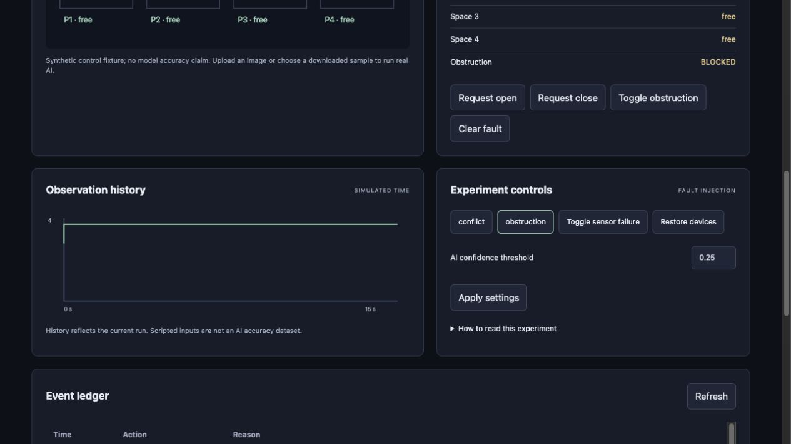

# Smart parking occupancy and gate

A camera and four virtual proximity readings estimate parking-space availability. Only agreement produces a free or occupied decision; disagreement reserves the space. A separate gate state machine requires fresh clear obstruction evidence before closing, including during manual requests. This is a software simulation prototype, not a certified gate controller.

**Raspberry Pi targeted · desktop simulation tested · AI-assisted personal project.** Physical deployment is pending.



## Run locally

```sh
python3.12 -m venv .venv
.venv/bin/python -m pip install -r requirements.txt
.venv/bin/python app.py
# Open http://127.0.0.1:8812
```

Control scenarios run without pretrained models. For real inference, complete [model setup and demonstration](docs/setup-and-demo.md). The source archive excludes pretrained backbones and COCO photographs; a trained waste head is included where applicable.

## Measured comparison

| Metric | Baseline | Final | Scope |
|---|---:|---:|---|
| Vehicle detection F1 (score) | 0.386 | 0.581 | 78 COCO test images; IoU >= 0.5; threshold 0.25; 320 to 640 pixels |
| False free availability (slot-seconds) | 15.000 | 0.000 | 480 synthetic slot-seconds; final decision coverage 83.33% |
| Unsafe closure requests (cases) | 14.000 | 0.000 | 30 scripted closure cases; not a physical safety rating |

Higher resolution increased vehicle F1 from 0.386 to 0.581 at roughly 3.6 times detector latency. Conservative fusion eliminated 15 false-free slot-seconds on the scripted trace, but only 83.33% of slot-seconds received a definite decision. Accuracy on decided slots was 100%; counting unknowns as errors gives 83.33%, below the baseline 93.75%. Reserving uncertainty costs availability.

The four image regions are example vertical lanes, not calibrated real parking spaces. COCO object F1 is not parking occupancy accuracy. Only one motorcycle ground-truth instance occurs in the held-out test. Reflections, occlusion and shadows were explored with transformations, not a labeled parking deployment dataset. A stop/HOLD software state does not physically reopen a gate. Independent obstruction hardware, limit switches and electrical interlocks remain required.

## Evidence and documentation

- [Technical report PDF](docs/technical-report.pdf) and [editable Word report](docs/technical-report.docx)
- [Architecture](docs/architecture.png) and [state transition source](docs/state-machine.mmd)
- [Hardware interfaces and wiring plan](docs/hardware.md)
- [Dataset and model card](docs/model-and-data.md)
- [Dashboard panel guide](docs/dashboard-guide.md)
- [Code walkthrough, ten interview questions and exercises](docs/mentor-guide.md)
- [Version and failure history](docs/FAILURES.md)
- [Raw results](evidence/results.json), [comparison CSV](evidence/metrics.csv), and [test log](evidence/tests.txt)

## Validation scope

Raspberry Pi targeted, desktop simulation tested. No Pi, real sensor, electrical power, camera timing, motor or physical safety validation was performed. This is an AI-assisted personal engineering project; it does not establish professional seniority or independent authorship.

56 shared regression cases passed. Real inference and browser scenarios were checked separately. The benchmark and application clocks are separate: inference time is measured on the host; control traces use explicit simulation time. No production adoption, physical safety certification, Pi latency or measured energy is claimed.

Project contact: Abhijith Viswanathan · abhijithviswanathan03@gmail.com. Intended GitHub owner: abhijith-abhii. Repository publication requires that account's write access; no remote repository is claimed by this package.

## Generated stress input and additional graphs

[Explore the AI-generated image, actual model output and diagnostic graph](docs/generated-tests.md). The synthetic scene is available in the dashboard sample menu and is excluded from the held-out benchmark.
