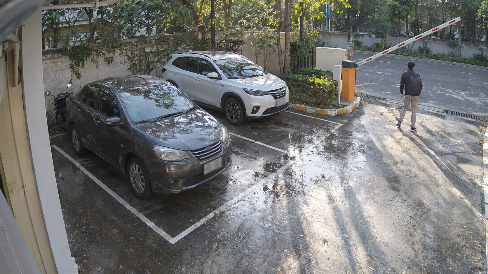
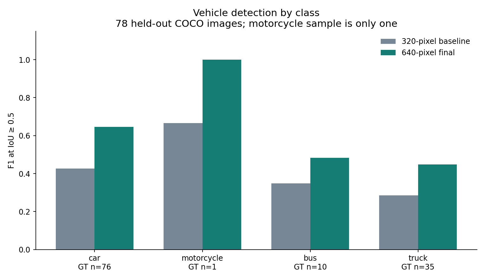

# Generated test image and diagnostic graphs

Human-reviewed synthetic scene: two cars, a heavily occluded motorcycle and one pedestrian; wet reflections and shadows. Counts are qualitative, with no bounding-box ground truth.

Detected candidates: person=1, car=2.

Exploratory generated input, n=1 per project, no statistical accuracy claim, no training or threshold tuning, excluded from headline held-out benchmarks.

Generated using the built-in image tool. Full prompt and SHA256 are retained in samples/generated-test-provenance.json. Select the generated stress scene in the local dashboard to run actual inference again. It is separate from real COCO and TrashNet test images.

## Prompt

Use case: photorealistic-natural. Asset type: synthetic computer vision test input for a parking gate prototype. Generate one realistic landscape view from a fixed elevated entrance camera of a small outdoor parking area. Show exactly two parked cars, one motorcycle partly occluded behind the nearer car, and one adult pedestrian walking near a raised barrier. Painted bays, wet pavement with reflections, long afternoon shadows. All people fictional, no legible license plates, no logos, no bounding boxes or text overlay. Include ordinary imperfect camera framing. The image will be labeled AI-generated synthetic input outside the image.

## Diagnostic graph

The graph below uses preserved evaluation results, not invented results for the generated scene.
